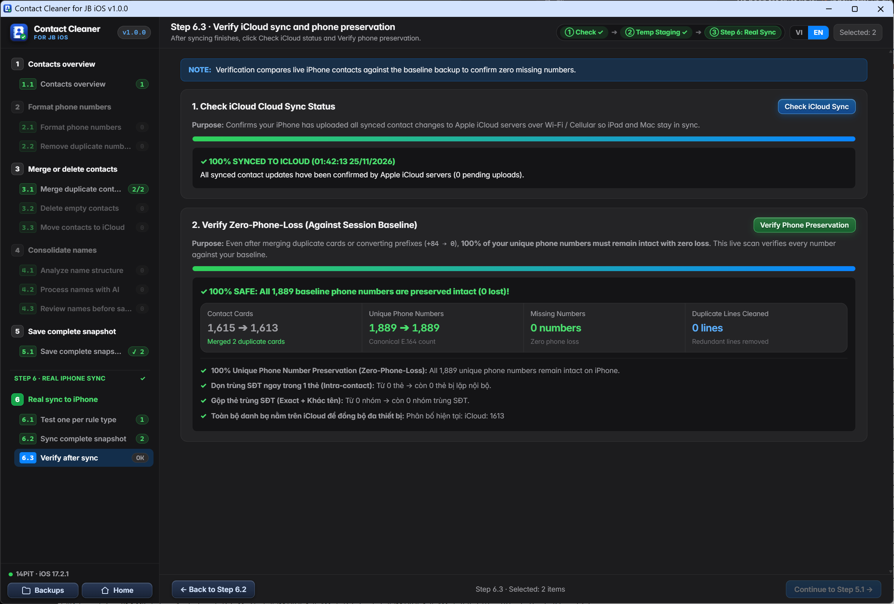
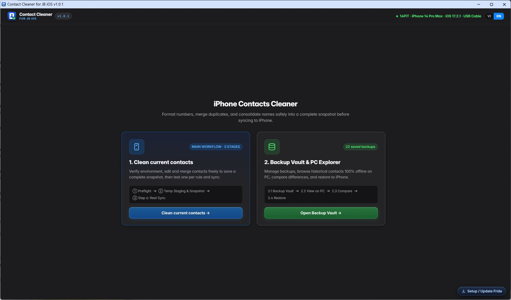
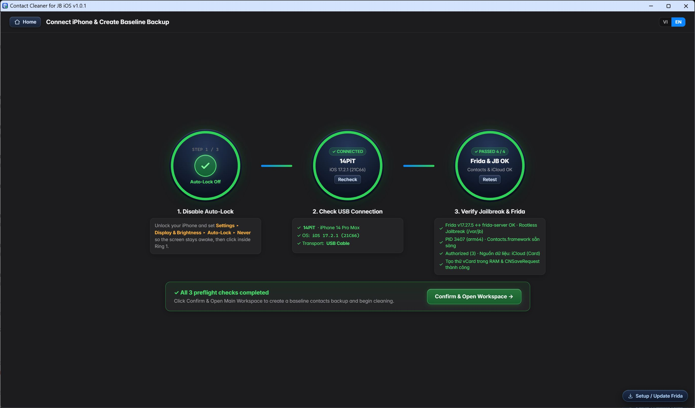

# Contact Cleaner for JB iOS

**[⬇ Download Latest Windows .exe (Releases)](https://github.com/pitroytech/ContactCleaner-JB-iOS/releases/latest)** | **[English](#english)** | **[Tiếng Việt](#tiếng-việt)**

| 1. Home Screen (Clean Contacts & Offline Backup Vault) | 2. 3-Step USB & Frida Preflight Check |
|---|---|
|  |  |

---

## English

**Contact Cleaner for JB iOS** is a standalone Windows desktop tool that cleans, normalizes, and merges iPhone contacts over a USB cable. All processing happens locally between your PC and iPhone over USB (nothing is uploaded to external servers). Once changes are written to your iPhone, iOS automatically syncs the cleaned contacts to iCloud and updates your iPad, Mac, and other Apple devices.

- **Latest Release:** [`v1.1.1` (`ContactCleaner_JB_iOS_v1.1.1.exe`)](https://github.com/pitroytech/ContactCleaner-JB-iOS/releases/latest) (Windows 10/11 64-bit standalone GUI, no Python required)
- **Interface Languages & Regions:** Supports 100+ countries/regions (`Step 1.1` searchable country selector automatically switches to `EN` outside Vietnam and remembers your choice permanently)
- **Data Safety:** Automatic dual backups (`.vcf` + `.json`), staged offline review before any write, 1-sample pilot sync, and live Zero-Phone-Loss verification

### Main Features

1. **Merge Duplicate Contacts Without Losing Data (Steps 3.1 to 3.3)**
   - Groups duplicate contact cards that share the same phone number and merges all secondary numbers, emails, notes, and labels into one clean master card.
   - Moves stranded Local or SIM contacts into your main iCloud account so every Apple device stays in sync.
   - Finds blank or unnamed ghost cards for review and removal.

2. **Fix Split Names & Optional AI Name Cleanup (Steps 4.1 to 4.3)**
   - Joins fragmented `First / Middle / Last` name fields into a clean full name.
   - Supports optional export/import for bulk AI name cleanup and checks every returned row token-by-token so prices, order codes, and numbers (such as `15.8tr` or `1080ti`) are never dropped.
   - Lets you choose side-by-side between the Original name, the Rule suggestion, or the AI suggestion.

3. **Preview Draft, Pilot Sync & Zero-Phone-Loss Check (Steps 5.1 to 6.3)**
   - Compiles all edits into an offline draft first (`Step 5.1`). Nothing changes on your iPhone while you review Steps `1.1` through `5.1`.
   - Tests 1 representative contact per rule (`Step 6.1`) before writing the full batch (`Step 6.2`).
   - Re-scans the iPhone after sync (`Step 6.3`) to verify iCloud upload status and confirm that 100% of unique baseline phone numbers remain intact.

4. **Backup Vault, Offline PC Viewer & Rollback (`Backups` Screen)**
   - Saves timestamped `.vcf` + `.json` snapshots on your PC with SHA-256 verification and pin-lock protection (`🔒`) against accidental deletion.
   - Opens any past snapshot or local iTunes / Apple Devices / 3uTools / iDescriptor backup directly on your PC for search and export without connecting an iPhone.
   - Restores selected missing contacts or rolls back the full address book after saving an automatic `pre_restore_safety` backup.

5. **Global Phone Prefix Formatting & Custom AI Rule Pack Wizard (Steps 2.1 to 2.2)**
   - Converts phone prefixes consistently between domestic format and international E.164 format (`+1`, `+44`, `+49`, `+84`, and 100+ countries).
   - Includes a built-in Vietnam `11 -> 10` digit carrier pack plus a **Custom Country Pack Wizard (AI JSON)** in `Step 2.1` so you can generate, validate, and dry-run historical carrier or area-code prefix rules for your own country.
   - Removes duplicate phone lines stored inside the same contact card.

---

### Requirements Before You Start

- **Windows PC:** Windows 10 or Windows 11 (64-bit).
- **Apple USB Driver on PC:** Install **iTunes** or **Apple Devices** from the Microsoft Store so Apple USB device detection works in the background.
- **USB Cable:** Use a data-capable Lightning or USB-C cable (charge-only cables will not detect the iPhone).
- **Jailbroken iPhone:** iOS 12 to iOS 18 jailbroken with **Dopamine** (Rootless), **palera1n**, **checkra1n**, or **unc0ver**, with **Sileo** or **Zebra** installed.

---

### Step-by-Step Setup Until Connected

Follow these four parts in order the first time you set up your iPhone and PC.

#### Part 1: Keep the iPhone Screen Awake

> **CAUTION:** iOS blocks Frida from connecting when the screen is locked. Keep the iPhone unlocked on the Home Screen during connection and sync.

1. Unlock your iPhone to the Home Screen.
2. Open **Settings > Display & Brightness > Auto-Lock**.
3. Select **Never** while using Contact Cleaner. (You can restore your normal Auto-Lock timer after you finish.)

#### Part 2: Install OpenSSH on the iPhone (Optional, for 1-Click Frida Setup)

OpenSSH lets Contact Cleaner install or update `frida-server` directly over your USB cable without Wi-Fi.

1. Open **Sileo** (or **Zebra**) on your jailbroken iPhone.
2. Search for **OpenSSH** and install it.
3. Know your SSH password:
   - On checkra1n / unc0ver, the default `root` password is `alpine`.
   - On **Dopamine** (iOS 15-18 Rootless), use the `mobile` / `root` password you created when you first installed Dopamine.

#### Part 3: Install `frida-server` on the iPhone

Contact Cleaner already bundles Frida for Windows inside the `.exe`. Your iPhone only needs the **Frida** (`re.frida.server`) package installed. Choose **Method A** or **Method B**:

##### Method A: Automatic Install Over USB (If OpenSSH is installed)

1. Open `ContactCleaner_JB_iOS_v1.1.1.exe` on your PC.
2. Connect your unlocked iPhone via USB and tap **Trust** on the iPhone screen if prompted.
3. Click **Setup / Update Frida** in the bottom-right corner of the app window.
4. Select your jailbreak type (`Rootless arm64` for Dopamine iOS 15-18, or `Rootful arm` for iOS 12-14).
5. Enter your SSH Username (`root`) and your SSH Password, leaving the Wi-Fi IP field blank.
6. Click **Check SSH**, then click **Install on iPhone ->** and wait until it reaches `100%`.

##### Method B: Manual Install in Sileo on iPhone (No OpenSSH required)

1. Open **Sileo** on your iPhone and go to the **Sources** tab.
2. Tap **+** (Add Source), enter `https://build.frida.re`, and tap **Add Source**.
3. Open the **Frida** source, select the **Frida** package (`re.frida.server`), and install it.

#### Part 4: Connect Through the 3 Preflight Rings

1. On the Contact Cleaner home screen, switch to **EN** in the top-right corner and click **Clean current contacts ->**.
2. **Ring 1 (Disable Auto-Lock):** Click inside Ring 1 after setting Auto-Lock to **Never** on your iPhone.
3. **Ring 2 (Check USB Connection):** Confirm your iPhone model and iOS version appear under Ring 2.
4. **Ring 3 (Verify Jailbreak & Frida):** Keep your iPhone unlocked on the Home Screen while Ring 3 verifies `frida-server` and Contacts access. Allow Contacts permission on the iPhone if asked once.
5. Click **Confirm & Open Workspace ->**. The app saves an automatic baseline backup (`.vcf` + `.json`) on your PC and opens Step `1.1`.

---

### Connection Troubleshooting

| Symptom | Cause | Fix |
|---|---|---|
| **Ring 2 says "No iPhone detected over USB"** | Missing Apple USB driver, charge-only cable, or untrusted PC. | Install iTunes or Apple Devices on Windows, use a data cable, unlock the iPhone, and tap **Trust This Computer**. |
| **Ring 3 fails to connect to Contacts** | The iPhone screen is locked, or `frida-server` is not installed. | Swipe up to the iPhone Home Screen so it stays unlocked, then click **Check Environment & Frida** again. |
| **Check SSH says "Authentication failed"** | Custom password set during Dopamine setup. | Click the eye icon in the SSH Password box and enter the password you set in Dopamine (instead of `alpine`). |
| **Frida version mismatch** | PC Frida runtime and iPhone `frida-server` are on different versions. | Open **Setup / Update Frida** (bottom-right), click **Check Updates**, then click **Install on PC** and **Install on iPhone ->**. |

---
---

## Tiếng Việt

**Contact Cleaner for JB iOS** là phần mềm máy tính Windows chạy độc lập giúp gộp danh bạ trùng, dọn tên bị tách vụn và chuẩn hóa đầu số trên iPhone đã Jailbreak qua cáp USB. Toàn bộ dữ liệu chỉ xử lý cục bộ giữa máy tính và iPhone của bạn (không tải lên bất kỳ máy chủ bên ngoài nào). Ngay sau khi ghi vào iPhone, iOS sẽ tự động đồng bộ danh bạ sạch lên iCloud và cập nhật cho iPad, Mac cùng các thiết bị khác.

- **Bản tải về mới nhất:** [`v1.1.1` (`ContactCleaner_JB_iOS_v1.1.1.exe`)](https://github.com/pitroytech/ContactCleaner-JB-iOS/releases/latest) (chạy thẳng trên Windows 10/11 64-bit, không cần cài Python)
- **Ngôn ngữ & Quốc gia:** Hỗ trợ hơn 100 quốc gia (chọn nhanh ở Bước `1.1`, tự động chuyển sang Tiếng Anh nếu ở ngoài Việt Nam và lưu lại cho các lần mở sau)
- **An toàn dữ liệu:** Tự động sao lưu kép (`.vcf` + `.json`) đầu phiên, duyệt nháp trước khi ghi, chạy thử 1 mẫu đại diện và kiểm tra bảo toàn 100% số điện thoại sau khi đồng bộ

### Các Tính Năng Chính

1. **Gộp thẻ trùng SĐT không mất thông tin (Bước 3.1 đến 3.3)**
   - Gom các thẻ liên hệ trùng số điện thoại về một thẻ chính duy nhất nhưng giữ nguyên toàn bộ số phụ, email, nhãn và ghi chú.
   - Chuyển các liên hệ nằm lẻ trên máy hoặc SIM vào tài khoản iCloud chính để đồng bộ xuyên suốt các thiết bị.
   - Lọc riêng các thẻ trống không tên, không số điện thoại để dọn sạch.

2. **Dọn tên bị tách rời & Kiểm định bằng AI (Bước 4.1 đến 4.3)**
   - Ghép gọn các trường Họ, Đệm, Tên bị tách vụn thành tên hiển thị hoàn chỉnh.
   - Hỗ trợ xuất/nhập xử lý tên hàng loạt bằng AI và tự động kiểm tra từng từ, từng con số (`15.8tr`, `1080ti`, mã đơn...) để không bao giờ làm rơi thông tin.
   - Cho phép chọn trực quan trên từng dòng giữa `1. Giữ gốc`, `2. Theo gợi ý quy tắc`, hoặc `3. Theo AI`.

3. **Duyệt nháp, Chạy thử 1 mẫu & Kiểm tra Không-Mất-Số (Bước 5.1 đến 6.3)**
   - Mọi thao tác từ Bước `1.1` đến `5.1` chỉ nằm trên bản xử lý tạm ở máy tính, chưa chạm vào iPhone.
   - Bước `6.1` ghi thử đúng 1 liên hệ đại diện cho mỗi nhóm trước khi đồng bộ toàn bộ ở Bước `6.2`.
   - Bước `6.3` quét lại iPhone để xác nhận đã tải lên iCloud và đối chiếu đủ 100% số điện thoại duy nhất so với bản gốc đầu phiên.

4. **Kho sao lưu, Xem danh bạ cũ trên PC & Khôi phục (`Kho sao lưu`)**
   - Lưu giữ các bản chụp `.vcf` + `.json` kèm kiểm tra `SHA-256` và nút ghim khóa (`🔒`) chống xóa nhầm.
   - Mở xem, tìm kiếm và xuất lẻ danh bạ cũ hoặc trích xuất trực tiếp từ bản sao lưu iTunes / Apple Devices / 3uTools / iDescriptor ngay trên máy tính mà không cần cắm iPhone.
   - Khôi phục chọn lọc từng liên hệ hoặc khôi phục nguyên trạng toàn bộ sổ danh bạ bất cứ lúc nào.

5. **Chuẩn hóa đầu số đa quốc gia & Tạo bộ đầu số riêng bằng AI JSON (Bước 2.1 đến 2.2)**
   - Đồng bộ đầu số thống nhất về dạng nội địa hoặc quốc tế E.164 (`+84`, `+1`, `+44`...), tích hợp sẵn bộ đổi 21 đầu 11 số về 10 số của Việt Nam và **Wizard tạo bộ đầu số riêng theo quốc gia bằng AI JSON** ngay tại Bước `2.1`.
   - Xóa các dòng số điện thoại bị lưu lặp lại bên trong cùng một thẻ liên hệ.

---

### Hướng Dẫn Cài Đặt & Kết Nối Nhanh

1. **Giữ màn hình iPhone luôn mở khóa:** Vào **Cài đặt > Màn hình & Độ sáng > Tự động khóa > Không** (`Never`) và luôn để iPhone ở **Màn hình chính** trong lúc kết nối.
2. **Cài gói Frida trên iPhone (chọn 1 trong 2 cách):**
   - **Cách nhanh trên Sileo:** Mở **Sileo > Nguồn (Sources)**, thêm nguồn `https://build.frida.re` rồi cài gói **Frida** (`re.frida.server`).
   - **Hoặc cài tự động 1 chạm qua cáp USB:** Cài gói **OpenSSH** trong Sileo, mở phần mềm trên PC, bấm nút **Cài / Cập nhật Frida** góc dưới phải, nhập mật khẩu SSH (`alpine` hoặc mật khẩu đặt lúc cài Dopamine), bấm **Kiểm tra SSH** rồi bấm **Cài cho iPhone ->**.
3. **Kết nối vào máy:** Cắm cáp dữ liệu nối iPhone vào PC Windows 10/11 (đã cài sẵn iTunes hoặc Apple Devices), bấm qua 3 vòng kiểm tra rồi nhấn **Tải danh bạ & Bắt đầu duyệt ->**.
